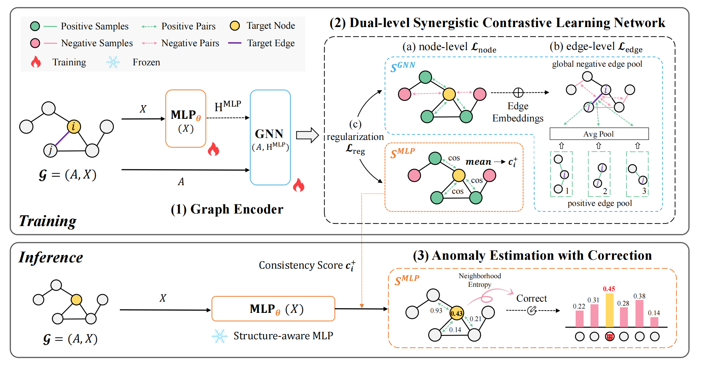

# 🌐 SCALER: An Effective, Efficient, and Scalable Approach for Unsupervised Graph Anomaly Detection

This repository contains the official implementation of the paper **"SCALER: An Effective, Efficient, and Scalable Approach for Unsupervised Graph Anomaly Detection"**.

## 🏗️ Model Framework

<p align="center">
  
</p>
<p align="center">
    The overview framework of <strong>SCALER</strong>, a self-supervised MLP-GNN learning framework for unsupervised graph anomaly detection.
</p>

## 🛠️ Environment Setup

The code is tested under **Python 3.9+** with these additional libs installed:
https://data.pyg.org/whl/
```bash
dgl==1.1.2+cu117
torch==2.0.0+cu117
torch-geometric==2.5.2+cu117
torch-cluster==1.6.3+cu117
torch-scatter==2.1.2+cu117
torch-sparse==0.6.18+cu117
tqdm==4.64.1
numpy==1.26.4
mkl==2024.0.0
scikit-learn
packaging
torchmetrics
```

## ⚡ Training and Evaluation

To run SCALER on each dataset: run.sh

## 📚 Citation
